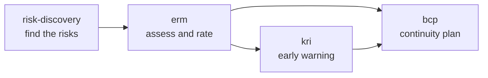

# BCP Skill - Building a Business Continuity Plan to Ready, Respond and Recover

**License**: Apache-2.0\
**Specification**: agentskills.io framework compatible\
**Author**: wai-kwan (https://github.com/wai-kwan)

An AI agent skill that **develops a business continuity plan (BCP) for one abrupt risk or crisis scenario**, such as a major fire, flooding, a critical IT outage, a cyber breach, a product recall or a bank failure. The plan is built in three phases:

- **Ready**: everything prepared now, before the plan is ever activated.
- **Response**: time-boxed actions from the first hour through 3, 6, 12, 24 and 48 hours and beyond, to keep the Critical Business Functions running.
- **Recover**: the return to normal.

A BCP is rarely finished in one sitting. The skill builds the plan over several sessions: version 1 is a balanced outline of every section, and each later version makes every section more detailed. Each version comes as a Word document, an action tracker and a progress summary that the next session picks up from.

## Why use it
- **Starts from your context.** The skill first establishes the objective of the plan, your organisation, the scenario and the assets to protect, from your prompt, your documents, an existing plan or your website.
- **Balanced at every version.** No section is left behind: every version covers the whole plan, and each new version raises all sections by one level of maturity.
- **Never invents facts.** Names, systems, sites, suppliers and times come from you. Anything unknown or assumed is marked `[TBC: ...]` and kept on a gap list.
- **Plain language.** Technical terms such as RTO or Critical Business Function are explained in the same simple words every time, whichever AI model runs the skill.
- **Few questions at a time.** It asks 1 to 3 questions per round, offers a suggested answer where it helps, and accepts "skip" or "that's enough for today" at any point.
- **Tailored, not templated.** Sections that do not fit the scenario are left out, and items the scenario needs are added, with every decision recorded.

## How it works

### 1. Context first
Before drafting, the skill makes sure it has the essential context, in this order:

1. **The objective of the BCP**: what the plan must achieve.
2. **The entity**: background information, what it does, its size, and its main sites, people, systems and suppliers.
3. **The scenario**: the one risk or crisis the plan is for.
4. **The assets to protect**: people, key activities, sites, systems and data, stock, equipment, customer relationships, reputation.

Useful context such as the country of operation, peak periods, key customers, existing arrangements and past incidents is used when available, and otherwise assumed and marked for confirmation. If the country is not given, the skill assumes the country where it is being used, when that information is available.

Context can come from the prompt, uploaded documents, an existing or outdated BCP, the organisation's website (or text pasted from it), or the outputs of the companion skills.

### 2. The right scenario
A BCP is for an **abrupt event** that suddenly threatens the business and needs an immediate response mapped out in advance. Typical scenarios: major fire, major flooding, extreme weather disruption, critical IT system outage, cybersecurity breach, large-scale product recall, bank failure, utility or telecoms outage, pandemic, sudden failure of a key supplier, sudden loss of a key person, security threat or civil unrest, and sudden suspension of a licence.

Slowly developing risks, such as losing market share, are not BCP scenarios: the skill says so and suggests the abrupt event linked to them. If you are not sure which scenario to plan for, it proposes 2 to 3 candidates with reasons and a recommendation. Each plan covers **one main scenario**, plus any related scenario it is likely to trigger (for example a fire that also takes out the IT systems).

### 3. Versions that grow in balance
| Level | Name | What it looks like |
|---|---|---|
| 1 | Outline | Key elements present in every section, roles rather than names, assumptions marked |
| 2 | Developed | Main facts confirmed, every action owned, main arrangements identified |
| 3 | Detailed | Names and contacts, step by step procedures and checklists, contracts and legal confirmations in place |
| 4 | Validated | Tested in an exercise and updated afterwards |

Version 1 is Level 1 throughout. Each later version aims to raise every section by one level, and no section may lag more than one level behind. A new version is saved when you ask for it, when a substantive point is reached (for example every section raised one level, or about 8 to 10 gaps closed), or when the session ends.

## What the plan contains
| Section | Contents |
|---|---|
| Document control | Version, owner, approver, review date, distribution, version history |
| 1 Introduction | Purpose and scope, scenario, objectives, assumptions |
| 2 Business Impact Analysis | Critical Business Functions ranked, with the maximum tolerable disruption, recovery time and data loss targets, minimum service levels and dependencies |
| 3 Roles and responsibilities | Crisis Management Team with alternates, key personnel, decision rights |
| 4 Critical resources | People, IT systems and data, equipment, alternate sites, suppliers, vital records, emergency funds and insurance |
| 5 Activation and escalation | Triggers (including KRI thresholds), severity levels, activation steps, logs |
| 6 Phase 1: Ready | Preparation actions with owners and due dates |
| 7 Phase 2: Response | Time windows, each with objectives, actions, communications due and a completion check |
| 8 Phase 3: Recover | Recovery order, restoration, backlog, stand-down criteria, post-incident review |
| 9 Communications | Stakeholder map; internal communications, including notification to the Board and senior management; external and media communications, including boilerplate responses to anticipated enquiries; regulatory notifications; message templates |
| 10 Testing and maintenance | Exercises, training, review schedule |
| Appendices | Contact directory and call tree, logs, situation report, role cards, message templates, glossary |

The skill anticipates the enquiries an event is likely to bring, such as "Is my order affected?", "Was anyone hurt?" or "When will service be back?", and drafts short boilerplate responses for each, for you to approve.

### Response windows
Windows are chosen from the shortest recovery times and the nature of the scenario: `T+0 to 1h`, `T+1h to 3h`, `T+3h to 6h`, `T+6h to 12h`, `T+12h to 24h`, `T+24h to 48h`, and beyond (for example `Day 3 to 7`, `Week 2 onwards`). Life safety always comes first, and every Critical Business Function is addressed in a window that ends no later than its recovery time objective.

## Outputs
Each version produces four files, named with a short slug and the version number:

```
warehouse-fire_bcp_v2.docx           The plan (Word)
warehouse-fire_bcp_v2.md             The same plan in markdown
warehouse-fire_bcp_actions_v2.csv    Action tracker, one row per Ready, Response and Recover action
warehouse-fire_bcp_summary_v2.md     Progress summary: maturity by section, context and sources, gaps closed and open
```

Earlier versions are never overwritten. The action tracker uses 9 columns and opens cleanly in Excel, Google Sheets or Numbers:

```csv
Action ID,Phase,Window,Action,Owner,CBFs Protected,Due or Trigger,Status,Notes
RS1,Response,T+0 to 1h,"Call the fire service, evacuate the warehouse and assemble at the assembly point",Site Incident Controller,All,Immediately,Planned,Life safety first
```

## Continuing a plan
Start a new session with any of these:
- the latest plan and summary from this skill;
- a plan only, from this skill or written elsewhere, in Word, PDF, markdown, a spreadsheet or pasted text. The skill maps it onto its structure, keeps your wording, assesses each section's maturity and builds a gap list;
- a request to add a related scenario to an existing plan.

If you give it a file, the skill reads that file. Otherwise it reads the file you name, or the latest version in the workspace, and asks if in doubt.

## Companion skills
The bcp skill works on its own and is designed to work with three companion skills:

| Skill | What it adds |
|---|---|
| [erm](https://github.com/wai-kwan/enterprise-risk-management) | A risk register row is the best scenario input: its causes and effects describe the scenario and its impacts, and its reductive controls become Ready and Response actions |
| [kri](https://github.com/wai-kwan/key-risk-indicator) | Red thresholds of key risk indicators become ready-made activation triggers |
| [risk-discovery](https://github.com/wai-kwan/risk-discovery) | Helps decide which risks need a plan first |



## Installation
Place the `bcp` skill folder in your workspace or your global agent skills directory. As the [agentskills.io specification](https://agentskills.io/specification) requires, `SKILL.md` sits at the top of the folder and the folder name (`bcp`) matches the skill `name`.

### Workspace setup (local repo)
```
your-project-repository/
└── .github/
    └── skills/
        └── bcp/
            ├── SKILL.md
            └── references/
```

### Claude Code (all projects)
Copy the folder to `~/.claude/skills/bcp/`.

### Direct CLI installation (agentskills CLI)
```bash
npx skills add wai-kwan/business-continuity-plan
```

### Claude (claude.ai)
Download the packaged `bcp.skill` file from this repository and upload it under Settings, Capabilities, Skills, or use the Save skill button on the file card. Code execution should be enabled so the skill can create the files.

### Recommended: install the companion skills
```bash
npx skills add wai-kwan/enterprise-risk-management
npx skills add wai-kwan/key-risk-indicator
npx skills add wai-kwan/risk-discovery
```

## Getting the best results
**Be proactive: share as much, and as specific, information as you can at every session, rather than waiting for the skill to ask.** The skill asks only 1 to 3 questions at a time, so a plan built from answers alone takes many rounds. Anything you volunteer is folded into the plan straight away, and the plan is refined and completed far sooner.

Useful things to share up front, or at any point:
- the objective of the plan and the assets you most need to protect;
- background on your organisation, your sites, key systems, suppliers and customers;
- the people who will take on the crisis roles, and their alternates;
- existing documents, such as an old BCP, emergency procedures, insurance summaries, supplier contracts or organisation charts;
- recovery expectations, such as how long each key activity can stop and how quickly it must be back;
- corrections to anything marked `[TBC]` in the latest version.

Specific beats general. "Customer service must be answering calls within 1 hour, run from head office by the Customer Service Manager with the Team Leader as backup" improves the plan more than "customer service is important".

## Quick start
Ask in plain language, for example:

- `Help me develop a BCP for a major fire at our main warehouse.`
- `/bcp We are a 50 person accounting firm in Kuala Lumpur. Build a business continuity plan for a ransomware attack.`
- `Create a business continuity plan for risk R4 in my risk_register.csv.`
- `We need a BCP but are not sure which crisis to plan for. Can you help?`
- `Continue our BCP from warehouse-fire_bcp_v2.docx and the summary.`
- `Here is our 2019 business continuity plan. Update it for a flooding scenario.`

## Skill contents
```
bcp/
├── SKILL.md                              # The workflow: context, scenario, versions, outputs
└── references/
    ├── plan-template.md                  # Plan structure, maturity levels by section, scenario guidance
    ├── bia-and-response-windows.md       # Business Impact Analysis and Response windows
    ├── plain-language-terms.md           # Fixed plain language explanations of technical terms
    └── session-outputs.md                # Plan conventions, action tracker rules, summary template
```

## Limitations
- Assumptions are marked `[TBC]` and must be confirmed. The plan is only as good as the facts behind it.
- Regulatory notification duties and deadlines are proposed for guidance and must be confirmed with a legal adviser.
- The skill cannot test the plan. Level 4 needs a real exercise, such as a tabletop exercise with the Crisis Management Team.
- Reading a website needs browsing access. Without it, paste the relevant text into the conversation.

## License
[Apache-2.0](LICENSE)

## Author
Written by [wai-kwan](https://github.com/wai-kwan). Part of a family of enterprise risk management skills with [erm](https://github.com/wai-kwan/enterprise-risk-management), [kri](https://github.com/wai-kwan/key-risk-indicator) and [risk-discovery](https://github.com/wai-kwan/risk-discovery).
